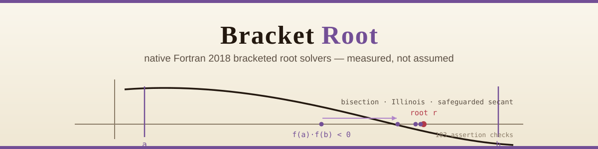
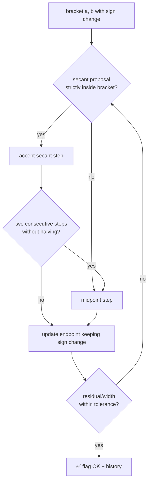
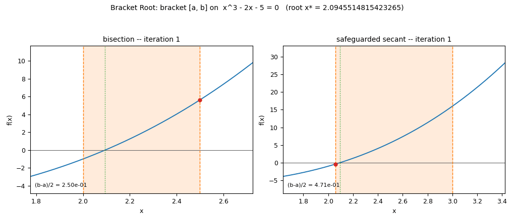

<div align="center">



# 🔲 Bracket Root

### Native Fortran 2018 bracketed root solvers — measured, not assumed

**Converged/errored exit flags, per-iteration residual histories, and a measured method
comparison across bisection, Illinois and safeguarded secant. All solver code written
from scratch (Brent's book cited for context only, no code taken).**

[](https://github.com/khalil-official/bracket-root-fortran/actions/workflows/ci.yml)
[](LICENSE)
[](src)
[](tests)
[](.github/workflows/ci.yml)
[](https://github.com/khalil-official/bracket-root-fortran/stargazers)
[](https://github.com/khalil-official/bracket-root-fortran/commits)

[Quick start](#-quick-start) · [Solvers](#-model-summary) · [Animation](#%EF%B8%8F-results-gallery) · [Measured results](#-measured-results-real-run) · [References](#-references-context-only--all-solver-code-written-from-scratch)

</div>

---

## 🎯 Purpose and scope

Solve `f(x) = 0` for a scalar double-precision `f` when a bracket `[a, b]` with
`f(a)·f(b) < 0` is known. Three production solvers plus a baseline:

| solver | one-line summary | measured behaviour |
|---|---|---|
| `bisection` | midpoint; bracket halves every iteration | 44–47 iterations to `1e-14` (test set) |
| `illinois` | regula falsi + Illinois retained-value halving | 7–9 iterations; 12 vs 465 for plain regula falsi on a hard convex case |
| `safeguarded_secant` | secant steps constrained to the bracket, forced bisection backstop | 6–20 iterations; bracket halves at least every 3rd iteration |
| `regula_falsi` | classic false position (baseline only) | stagnates one-sidedly on convex/concave problems |

> **Out of scope:** multivariate systems, unbounded root search, even-multiplicity
> (tangent) roots, polynomial-specific methods.

## 🧮 Model summary

- **Bisection:** `x_k = a + (b-a)/2`; guaranteed `|x_k - r| <= w_0/2^k`.
- **Regula falsi:** secant-line zero through the bracket endpoints; superlinear while
  alternating, degrades to linear one-sided crawling on convex/concave `f`.
- **Illinois:** same proposal, but an endpoint retained on two consecutive iterations
  gets its stored value halved, breaking the crawl (asymptotic order ~1.44).
- **Safeguarded secant:** secant proposal from the two latest iterates, accepted only
  strictly inside the bracket (S1); after two consecutive non-halving iterations a
  midpoint step is forced (S2) — bisection-grade worst-case width contraction,
  secant-grade typical case.

Every solver returns `(root, residual, iterations, flag)` with documented codes:
`OK` (0), `INVALID_BRACKET` (1), `MAX_ITERATIONS` (2), `NOT_CONVERGED` (3).
Full formulas, guarantees, stopping criteria and symbol table:
[docs/model.md](docs/model.md).

### One iteration, safeguarded



## ⚡ Quick start

Requires `gfortran` and GNU make (Python only for regenerating figures).

```sh
# build and run the assertion suite (nonzero exit on failure)
make test

# or compile the library directly
gfortran -std=f2018 -Wall -Wextra -O2 -fall-intrinsics -c src/roots.f90
```

<details>
<summary><b>🧱 Architecture & module usage</b></summary>

```fortran
use bracket_root
call safeguarded_secant(f, 2.0_rk, 3.0_rk, 1.0e-14_rk, 1.0e-14_rk, 100, res)
if (res%flag == root_ok) print *, res%root, res%residual, res%iterations
```

```text
src/roots.f90            module bracket_root: 4 solvers, shared verified kernel,
                         error flags, step_record history, pure procedures
tests/test_roots.f90     assertion suite (make test) - 103 checks
examples/compare.f90     driver: 4 equations x 3 methods -> build/csv/*.csv
tools/make_results.py    reads the CSVs -> still figures, animated GIF,
                         run_summary.json (plotting only; solvers are Fortran)
docs/                    model.md, api.md, verification.md
docs/results/            generated figures, GIF, run_summary.json
Makefile                 all | test | run | results | clean
```

Full API (types, signatures, history recording): [docs/api.md](docs/api.md).

</details>

<details>
<summary><b>🔁 Regenerating all results</b></summary>

```sh
make run                              # driver -> build/csv/*.csv (histories + summary)
make results PYTHON=python            # figures, GIF, docs/results/run_summary.json
# pip install -r requirements.txt     # matplotlib, numpy, pillow (plotting only)
```

CI builds and runs the test suite on ubuntu gfortran with the same flags.

</details>

## ✅ Verification summary

`make test` runs 103 assertion checks, all passing in the reference run:

- known roots (4 equations × 3 solvers) within `1e-12`, flags `OK`;
- invalid brackets detected (same-sign endpoints, reversed bracket, non-finite `f(a)`,
  NaN endpoint) → `INVALID_BRACKET` for all solvers;
- tiny/zero iteration budgets → `MAX_ITERATIONS` with exact iteration counts;
- machine-precision stagnation on a synthetic step function → `NOT_CONVERGED`;
- bisection history: bracket half-width contracts by exactly `1/2` per iteration
  (ratio checked within `1e-9`), iterates always inside brackets;
- Illinois beats plain regula falsi on the hard convex case (12 vs 465, `>= 3x`
  asserted);
- endpoint-exact root returns immediately; flag names map correctly.

What this establishes and the limits: [docs/verification.md](docs/verification.md).

## 🔎 Limitations

- Scalar and bracketed only: a sign change on `[a, b]` is required; tangent roots and
  even multiplicities are rejected.
- Iteration counts are measurements at the stated tolerances, not universal constants.
- Verified on gfortran 16.2.0 (Windows/WinLibs) and ubuntu gfortran in CI; other
  compilers/platforms untested.
- Plotting/GIF tooling is Python; the numerical solvers themselves are pure Fortran.

---

## 🎞️ Results gallery

<div align="center">

**▶ Watch the bracket contract:**



<sub>Provenance: 46-frame animation rendered by <code>tools/make_results.py</code>
(Matplotlib/Pillow) directly from the Fortran solvers' recorded iteration histories —
<code>build/csv/cubic_bisection.csv</code> and
<code>build/csv/cubic_safeguarded_secant.csv</code>, written by
<code>examples/compare.f90</code> compiled with GNU Fortran 16.2.0
(<code>-std=f2018 -Wall -Wextra -O2 -fall-intrinsics</code>). Every frame is one
recorded solver iteration, labeled by iteration number; no solver data was
interpolated or invented.</sub>

</div>

### 📈 Measured results (real run)

GNU Fortran 16.2.0 (WinLibs), `-std=f2018 -Wall -Wextra -O2 -fall-intrinsics`,
driver tolerances `xtol = ftol = 1e-14`, `maxiter = 200`. All flags `OK`.
Machine-readable version: [docs/results/run_summary.json](docs/results/run_summary.json).

Iterations to convergence (final `|f(x)|` at exit):

| equation | bracket | reference root | bisection | Illinois | safeguarded secant |
|---|---|---|---|---|---|
| `x^3 - 2x - 5 = 0` | `[2, 3]` | 2.0945514815423265 | 46 (6.4e-14) | 8 (8.9e-16) | **6** (8.9e-16) |
| `cos x - x = 0` | `[0, 1]` | 0.7390851332151607 | 44 (8.4e-15) | 7 (0) | **6** (0) |
| `sin x = 1/2` | `[0, 1.5]` | π/6 = 0.5235987755982989 | 44 (9.8e-15) | **8** (0) | 14 (1.8e-15) |
| `x e^x = 1` | `[0, 2]` | W(1) = 0.5671432904097838 | 47 (7.2e-15) | **9** (2.2e-16) | 20 (2.2e-16) |

Hard convex case (`e^x - 2 = 0` on `[0, 5]`, tolerance `1e-12`, from the test
suite): **Illinois 12 iterations vs plain regula falsi 465** — the one-sided
stagnation the Illinois modification exists to fix.

### 🖼️ Static figures & raw data

- [convergence_comparison.png](docs/results/convergence_comparison.png) — convergence
  comparison across solvers
- [residual_histories.png](docs/results/residual_histories.png) — per-iteration
  residual histories
- [Recorded Fortran driver CSVs](docs/results/data/summary.csv) — all twelve
  method/equation histories in the same data directory

## 📚 References (context only — all solver code written from scratch)

- G. Dahlquist and A. Björck, *Numerical Methods in Scientific Computing* — false
  position, Illinois-type modifications, secant/bisection hybrids.
- R. P. Brent, *Algorithms for Minimization Without Derivatives* — context for
  safeguarded hybrid solvers; cited for historical background, no code taken.

## 🔑 License

MIT — see [LICENSE](LICENSE).

Calendar metadata: [date-record disclosure](docs/CALENDAR_HISTORY.md). Historical
calendar-record author dates are synthetic; original software commits and actual
committer dates are preserved.
